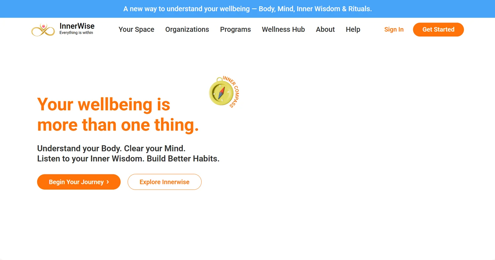
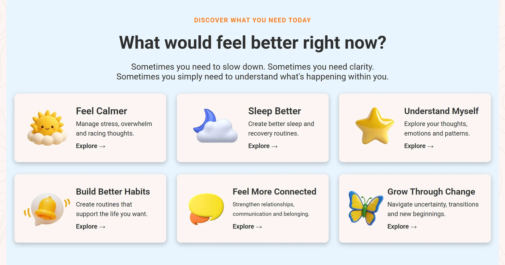
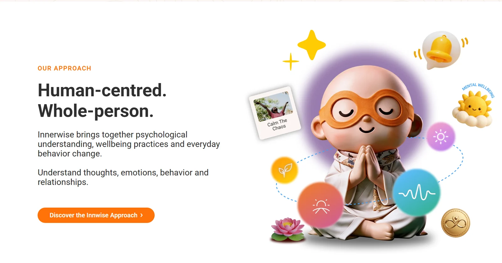
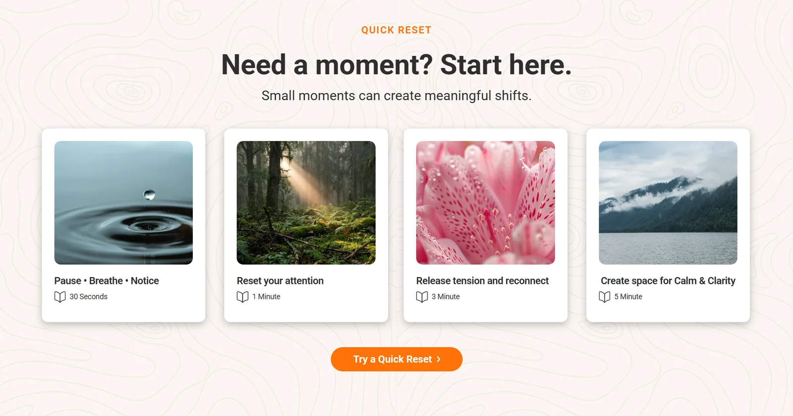
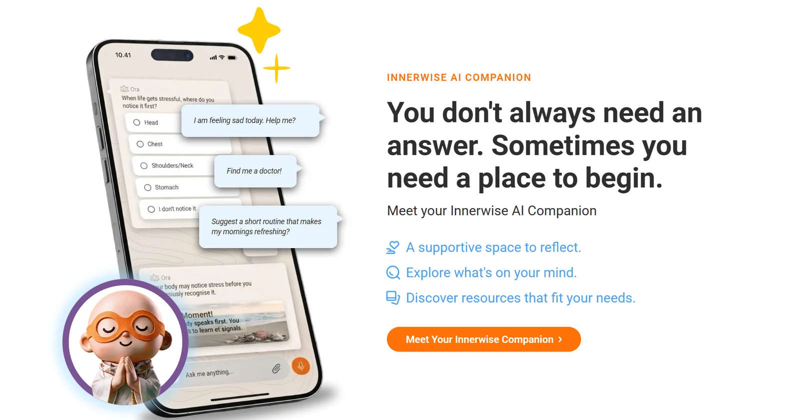
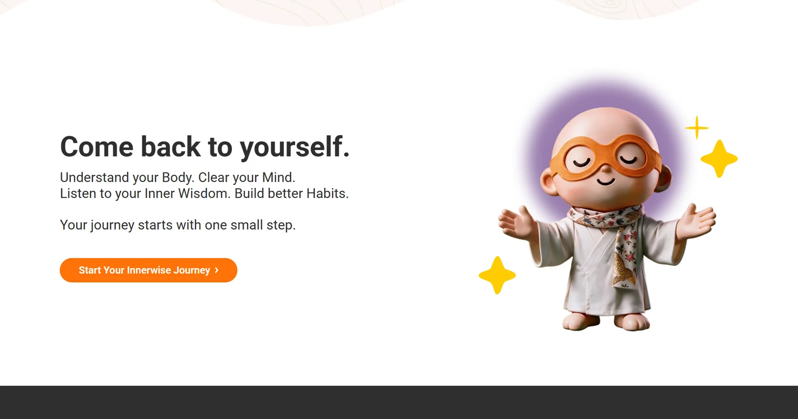

# Innerwise — Everything is within

A pixel-faithful implementation of the **Innerwise** landing page (Figma *Desktop – Home*, frame `1010:8`), built with React, TypeScript and Vite.

Innerwise is a whole-person wellbeing platform that brings together **Body, Mind, Inner Wisdom and Rituals** to help people understand themselves and build healthier ways of living.

**Live site:** https://innerwise-six.vercel.app/

---

## Screenshots

| | |
|---|---|
|  |  |
| **Hero** | **Discover what you need today** |
|  |  |
| **Our Approach** | **Quick Reset** |
|  |  |
| **Innerwise AI Companion** | **Final call to action** |

---

## Page sections

1. **Announcement bar & navigation** — seven items; Your Space, For Organizations, About and Help open mega-menus (click, or hover with intent delay; Escape / outside click / focus-out close them). Below 1200 px: Get Started + a full-screen drill-down menu (focus trap, scroll lock, Escape, focus restore)
2. **Hero** — two-tone headline, sub-heading, CTAs, Inner Compass badge, a decorative Quick Reset + pillars illustration in the Figma's reserved right-hand slot (stacks under the buttons below 1180 px), and the media slot
3. **Discover what you need today** — six need cards (3 × 2 grid on desktop)
4. **The Innerwise Framework** — Mind, Body and Inner Wisdom pillar cards, plus the Rituals banner
5. **Our Approach** — copy and the full Figma illustration group
6. **Quick Reset** — four short practice cards
7. **Innerwise AI Companion** — phone mockup, chat bubbles, avatar and feature list
8. **Explore & Play** — six activity tiles
9. **Meet Our Experts** — expertise copy and the expert video-call illustration
10. **FAQ** — centred, bordered accordion cards rendered from `config/faq.ts` (closed by default, independent toggles, smooth expand); "Still have a question?" panel
11. **Final CTA** — Figma wave shape and mascot artwork
12. **Footer** — brand row (logo, taglines, care note) above all seven link groups on one row (from `config/footer.ts`); wraps to 4 → 3 → 2 columns below 1200 px

## Motion

Sections fade/slide in as they scroll into view (staggered for card groups), cards lift and illustrations bob on hover, the two mascot illustrations float gently, the hero practice list cycles through its options, and a thin progress bar fills at the top as you scroll. Elements opt in with `data-reveal="up|left|right|scale"` (+ optional `data-reveal-delay`), driven by `src/lib/useScrollReveal.ts`. Everything is disabled for `prefers-reduced-motion` and falls back to fully visible without JavaScript or `IntersectionObserver`.

## Tech stack

| | |
|---|---|
| Framework | React 19 + TypeScript |
| Build tool | Vite 8 |
| Styling | Inline styles and component-scoped CSS, with Tailwind CSS 3 base layer |
| Linting | oxlint |
| Font | Roboto (Google Fonts) |
| Hosting | Vercel |

## Getting started

Requires **Node.js 20.19+ or 22.12+** (needed by Vite 8).

```bash
npm ci            # install dependencies
npm run dev       # start the dev server (http://localhost:5173)
npm run build     # type-check (tsc -b) and build to dist/
npm run preview   # serve the production build locally
npm run lint      # run oxlint
```

### Visual regression check

`scripts/visual-diff.mjs` (no dependencies — drives a local Chrome/Edge) snapshots the page at 375, 768 and 1440 px and reports changed pixels between two snapshots, writing highlighted diff images to `.visual/`:

```bash
npm run build && npm run preview          # in one terminal
npm run visual:snap -- before             # before a change
npm run visual:snap -- after              # after it
npm run visual:diff -- before after       # changed-pixel report per width
```

## Project structure

```
src/
├── components/
│   ├── layout/          # AnnouncementBar, Navbar (+ nav/: MegaMenu, MobileMenu, Logo, icons), Footer (+ footer/: FooterBrand, FooterLinkGroup)
│   ├── primitives/      # Button, Eyebrow
│   └── sections/        # one folder per page section (Hero, DiscoverSection, …)
├── config/
│   ├── assets.ts        # asset manifest — every image/icon path, with its Figma node
│   ├── links.ts         # all link destinations (placeholders until confirmed)
│   ├── navigation.ts    # nav items and mega-menu content (verbatim from the Figma nav frames)
│   ├── practices.ts     # Quick Reset practice names/durations (Quick Reset section + hero illustration)
│   ├── faq.ts           # FAQ questions/answers (local data — the FAQ section renders this list)
│   └── footer.ts        # footer link groups and brand copy
├── pages/HomePage.tsx   # assembles the page
└── index.css            # global styles, buttons, background pattern
public/assets/
├── icons/               # SVGs exported from Figma (logo, pillar icons, sparkles, wave, …)
└── images/              # WebP images exported from Figma at 2× with Figma's crops applied
docs/screenshots/        # README screenshots (not shipped with the site)
scripts/visual-diff.mjs  # zero-dependency visual regression snapshots
```

## Design fidelity

- **Source of truth:** the revised Figma *Desktop – Home* frame (1440 × 9636) plus the *Nav / … / Open* and *Web Nav* frames. At 1440 px every section starts at the Figma y-position. Deliberate deviations from that frame (where it contains layout glitches): the hero buttons keep their spacing below the sub-heading instead of overlapping it, the Quick Reset / AI / Final CTA buttons keep 40 px gaps, the footer is shown at its full 600 px, and the FAQ keeps its open/close icons.
- **Assets** are exported directly from the Figma file (vectors as SVG, rasters as 2× WebP with Figma's crops, masks and mirroring baked in). The production build is about 1.2 MB.
- **Copy** is reproduced from Figma, with approved fixes: "Innwise" → "Innerwise", the Inner Wisdom card link reads "Explore Inner Wisdom →", "3 / 5 Minutes", and a missing full stop in the FAQ.
- **Design source files** (the full Figma SVG export, raw extracted rasters and superseded assets) live in a local `design-source/` folder, which is git-ignored and never shipped.

## Responsive behaviour

Figma provides a desktop frame only; smaller layouts are adapted from it.

| Width | Layout |
|---|---|
| ≥ 1382 px | Figma desktop layout (shared side gutter `--page-gutter` in `index.css`: 36 px on phones, ≈48 at 768, ≈77 at 1440; the footer uses wider sides, the FAQ a 760 px reading column) |
| 1240–1381 px | Compact desktop (common 1280 / 1366 laptops): Discover stays 3 × 2, footer keeps all 7 columns in one row |
| 1200–1239 px | Desktop navigation (item padding eases so all 7 items fit), 2-column Discover grid, 4-column footer |
| ≤ 1199 px | Logo · Get Started · menu button (Figma *Web Nav* frames) |
| ≤ 1239 px | Discover cards switch to image-beside-text rows; Figma line breaks are dropped so text wraps naturally |
| ≤ 768 px | Stacked sections, 2-column footer |
| ≤ 640 px | Single-column Discover cards |

Checked with no horizontal scrolling at 360, 375, 390, 768, 1024, 1199, 1200, 1280, 1366, 1440 and 1920 px.

## Configuration

- **Links:** every `href` comes from `src/config/links.ts`. Destinations are placeholders (`#`) until the real URLs are confirmed.
- **Assets:** every image path comes from `src/config/assets.ts`, which also records the Figma node each asset came from.

## Deployment

The site deploys to **Vercel** automatically on every push to `main`. `vercel.json` sets the framework (Vite), the build command (`npm run build`) and the output directory (`dist`).
